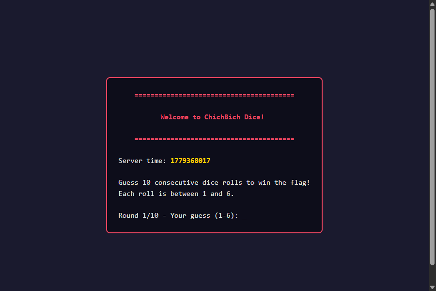
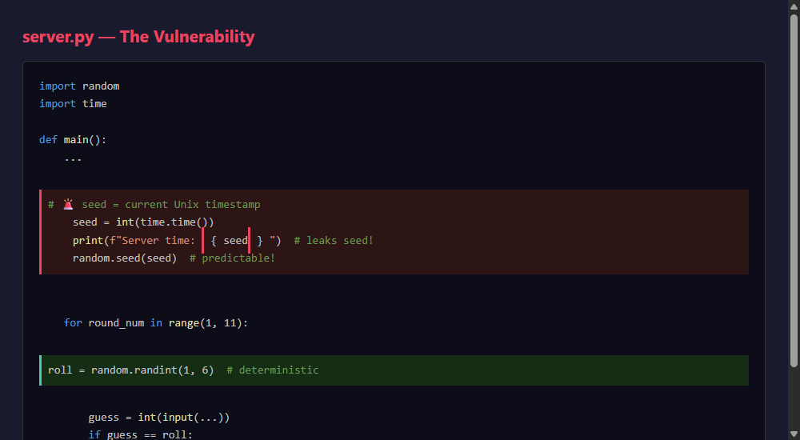
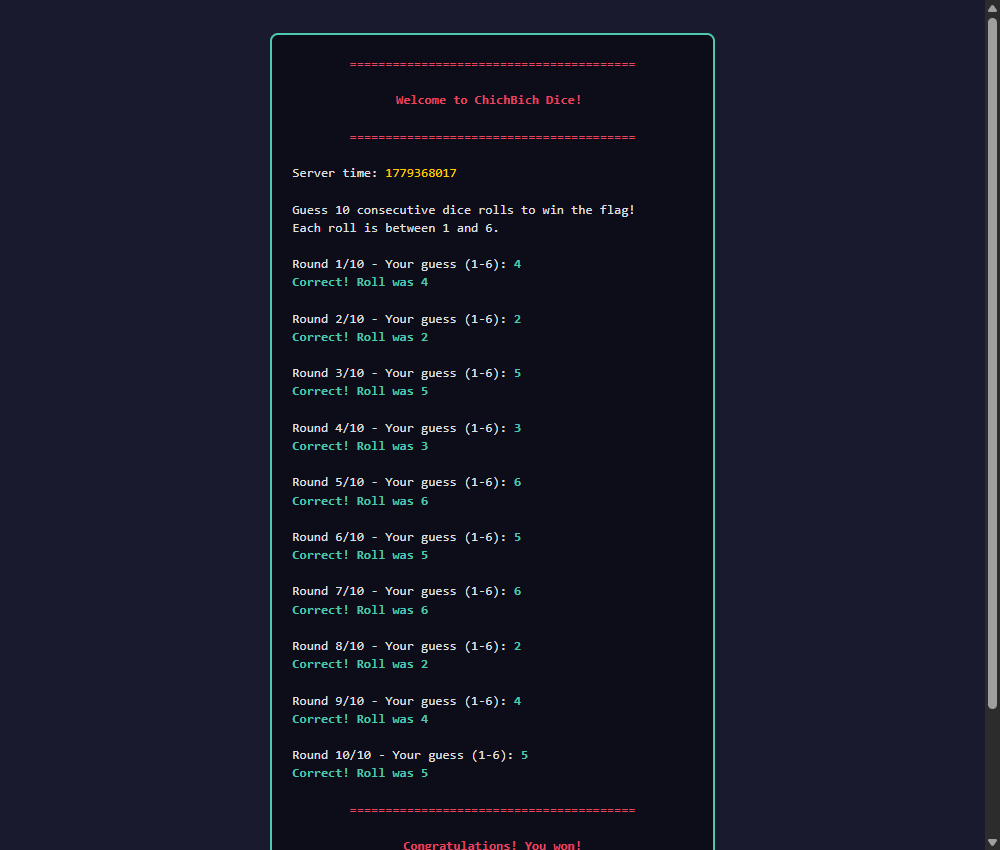
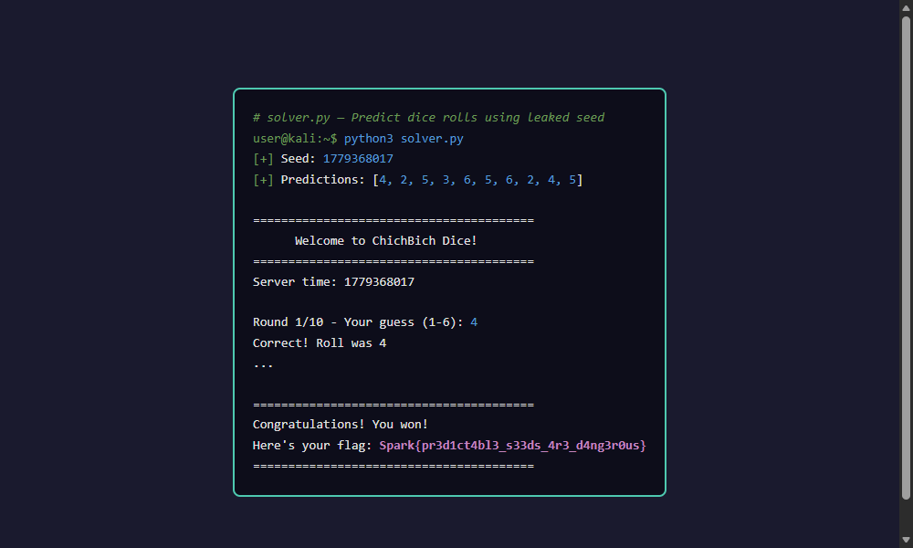

# Chichbich — Predictable PRNG Seed

**Challenge:** pwn (Random Number Prediction)  
**Difficulty:** Beginner  
**Flag:** `Spark{pr3d1ct4bl3_s33ds_4r3_d4ng3r0us}`

---

## Overview

Chichbich is a dice game running on port 9999. Guess 10 rolls correctly and win the flag. Each roll is supposed to be random — but the server accidentally tells you the seed it uses!

---

## Step 1: Recon

Connect to the server:

```bash
nc ip port
```



The banner shows:

```
Server time: 1779368017
```

That's the current Unix timestamp. The server prints it and uses it as the seed for `random`. This means we know exactly what "random" numbers it will generate.

---

## Step 2: Understanding the Vulnerability

Here's the server code:



```python
seed = int(time.time())          # current Unix timestamp
sys.stdout.write(f"Server time: {seed}\n")   # leaked!
random.seed(seed)                # predictable PRNG
```

Python's `random` module uses the **Mersenne Twister** algorithm. Given the same seed, it produces the exact same sequence of numbers every time. This is great for reproducible simulations but terrible for security.

The server:
1. Gets the current Unix timestamp
2. **Prints it to the banner**
3. Uses it as the seed for `random`
4. Generates dice rolls with `random.randint(1, 6)`

All we have to do is seed our local RNG with the same value and predict all 10 rolls.

---

## Step 3: The Exploit Logic

The core idea is three lines:

```python
import random
seed = 1779368017                 # copy from banner
random.seed(seed)                 # same seed = same sequence
print(random.randint(1, 6))       # predict roll #1
```

Run this ten times and you get the exact same rolls the server expects:



---

## Step 4: Automated Solver

Here's a clean solver using `pwntools`:

```python
from pwn import *
import random

io = remote('127.0.0.1', 9999)

seed = int(io.recv().decode().split("\n")[3].split(":")[-1].strip())
random.seed(seed)

io.sendline(str(random.randint(1, 6)).encode())

res = io.recvline()
io.recv()
while b'Correct' in res:
    io.sendline(str(random.randint(1, 6)).encode())
    res = io.recvline()
    print(res)
    print(io.recvline())

io.interactive()
```




---

## Step 5: Getting the Flag

Run the solver and after 10 correct guesses:

```
========================================
Congratulations! You won!
Here's your flag: Spark{pr3d1ct4bl3_s33ds_4r3_d4ng3r0us}
========================================
```

**Flag:** `Spark{pr3d1ct4bl3_s33ds_4r3_d4ng3r0us}`

---

## Key notes for Beginners

**`random` is not for security.** It's great for games, simulations, and testing — but never use it for passwords, tokens, or anything secret. Python's `secrets` module uses the operating system's cryptographically secure random generator and cannot be predicted.

**Time is a terrible seed.** Even if the server didn't print the seed, `time.time()` only has second precision. An attacker could try all seeds in a ±60 second window — only 121 possibilities. Always use `secrets.randbelow()` or `os.urandom()` for security-critical randomness.

**Always read the banner.** Servers often leak useful information in the connection banner. In this case, the seed was given away for free. 

---

## Contact

**Author : bangaalderson https://www.linkedin.com/in/bangaalderson/**
